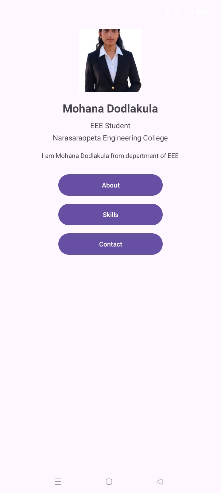
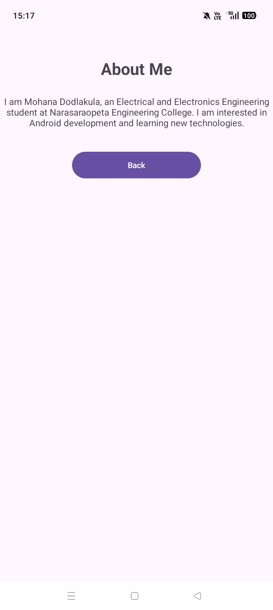
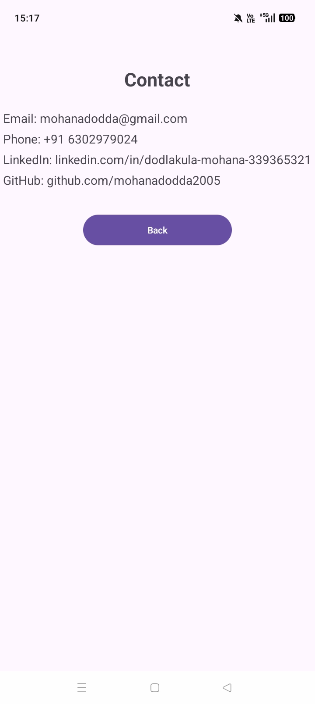
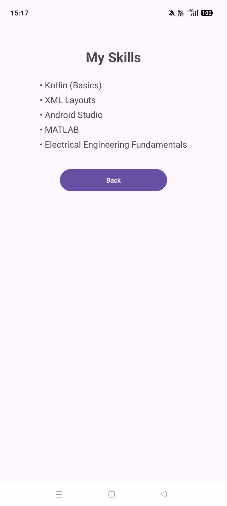
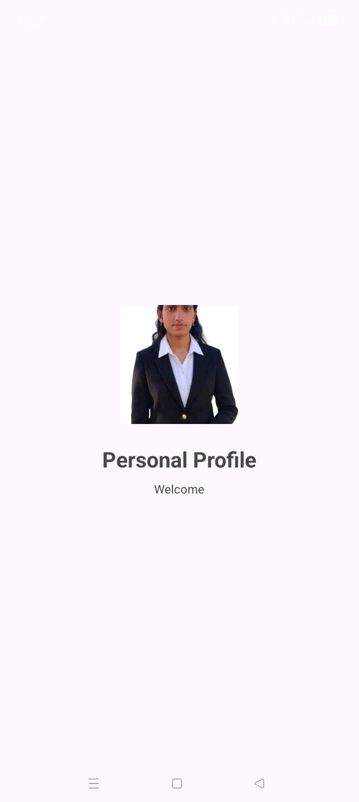

# Personal Profile App

An Android app that shows my personal profile, built with Kotlin and XML as part of the Sumerix Global internship (Task 1).

## Features
- Splash Screen
- Profile Screen (photo, name, branch, college)
- About Screen
- Skills Screen
- Contact Screen
- Navigation using Intents
- Material Design UI

## Tech Stack
- Kotlin
- XML layouts
- Android Studio
- Material Design 3

## Screenshots

## Author
Mohana Dodlakula
EEE Student, Narasaraopeta Engineering College
